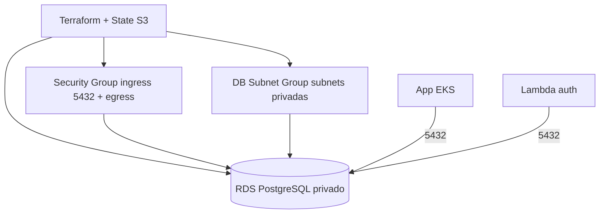

# tech-challenge-fase3-infra-db — Infraestrutura do Banco Gerenciado (Terraform)

Provisiona, via **Terraform**, o banco de dados **gerenciado** da solução: **Amazon RDS PostgreSQL**, privado, dentro da VPC criada pelo repositório de infraestrutura Kubernetes.

## Propósito

Criar e versionar o banco de dados relacional que sustenta a aplicação e a autenticação:
- **Amazon RDS PostgreSQL 14** (`db.t3.micro`), **privado** (`publicly_accessible = false`);
- **DB Subnet Group** nas subnets privadas;
- **Security Group** com **entrada** na porta 5432 (a partir da VPC) e **saída liberada** (necessária para a Lambda que usa este SG iniciar a conexão).

> Repositório **sem Dockerfile** — apenas código Terraform.

## Tecnologias

- **Terraform** (provider `hashicorp/aws ~> 5.0`), com **state remoto no S3**
- **AWS:** RDS PostgreSQL

## Pré-requisitos

- Terraform 1.5+
- Credenciais AWS
- Um **bucket S3** para o state (criado uma única vez, antes do primeiro `init`)

## Recursos e arquivos

| Arquivo | Conteúdo |
|---|---|
| `backend.tf` | Backend S3 (state remoto) |
| `data.tf` | Descoberta da VPC e subnets (fixadas por ID para evitar ambiguidade) |
| `rds.tf` | DB Subnet Group, Security Group (ingress + **egress**) e instância RDS |
| `variables.tf` | Variáveis (região, senha do banco, etc.) |

## Execução

```bash
# 1) Bootstrap: criar o bucket de state (uma vez)
aws s3 mb s3://tf-state-oficina-<ACCOUNT_ID>-use1 --region us-east-1

# 2) Init com backend S3
terraform init

# 3) Importar recursos já existentes (idempotente — traz para o state)
terraform import aws_db_subnet_group.oficina_db_subnet oficina-db-subnet-v3 || true
terraform import aws_security_group.rds_sg <SG_ID> || true
terraform import aws_db_instance.oficina_db oficina-db-prod || true

# 4) Plan + Apply
terraform plan -out=tfplan
terraform apply tfplan
```

## Pipeline de CI/CD (GitHub Actions — `.github/workflows/terraform-deploy.yaml`)

Disparada em Pull Request (`plan`) e no merge para `main` (`plan` + `apply`), com a branch protegida:
`init` (state no S3) → **`import`** dos recursos existentes → `fmt -check` → `plan` → `apply` (somente no push).

O passo de **import** é o que garante a **idempotência**: sem ele, o Terraform tentaria recriar RDS/SG/subnet-group que já existem (erro `already exists`). Ver **ADR-004**.

Secrets: `AWS_ACCESS_KEY_ID`, `AWS_SECRET_ACCESS_KEY`, `AWS_SESSION_TOKEN`.

## Arquitetura do componente



## Observações (AWS Academy)

- O `id` da conta e IDs de rede podem mudar em **reset** do lab — revisar o nome do bucket (`backend.tf`) e os IDs fixados (`data.tf`) nesse caso.
- O bloco **`egress`** do Security Group é obrigatório: sem ele, a Lambda (que usa este SG) não consegue iniciar a conexão com o RDS (`connect ETIMEDOUT`).
